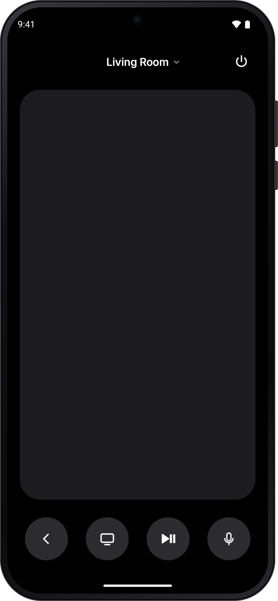
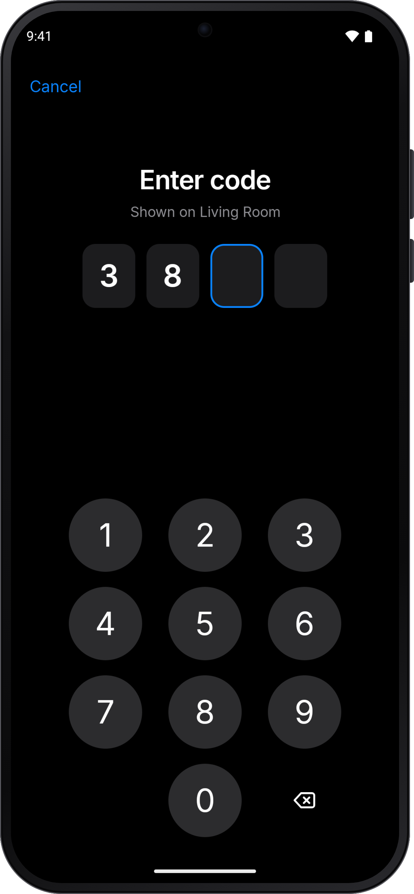
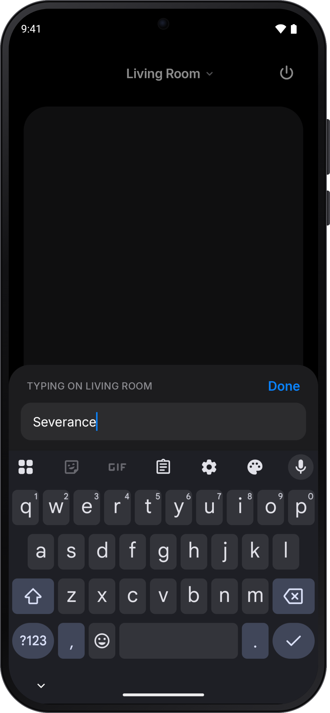
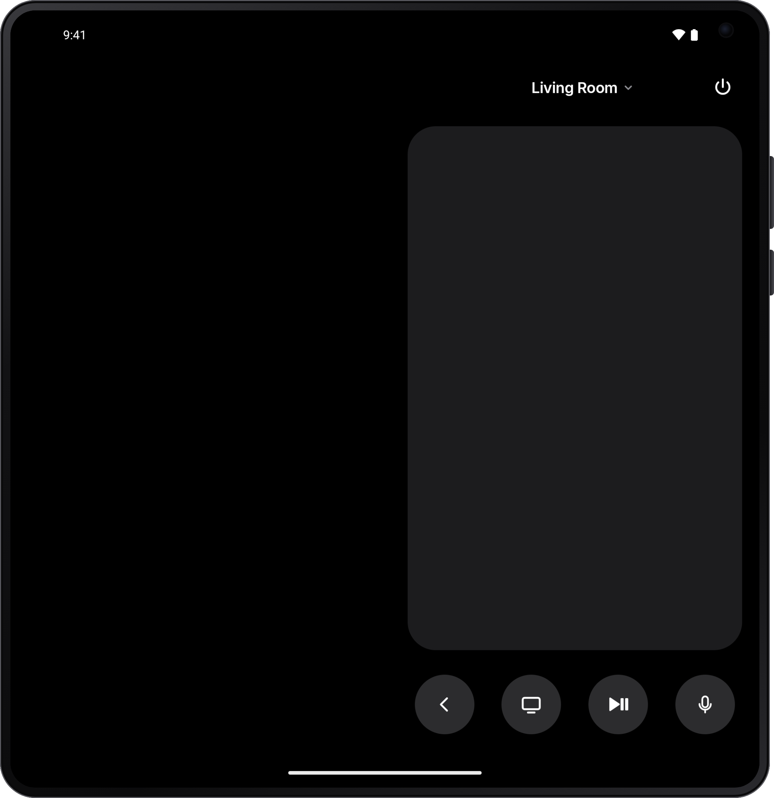

# Remote

An Apple TV remote for Android. Free, with no ads. It pairs with the TV and talks to it directly over
Wi-Fi, using the same Companion protocol as the iPhone's remote.

<p align="center">
  
  &nbsp;
  
  &nbsp;
  
</p>
<p align="center">
  
</p>

**Website:** https://dvdsgl.github.io/tv-remote

## Features

- **Touch surface.** Swipe to move, tap to select, sent to the TV as live touches.
- **Volume keys.** The phone's volume buttons control the TV while the app is open.
- **Keyboard.** Opens by itself when the TV asks for text, prefilled with what's in the field.
- **Light and dark.** Light is free; dark mode is a one-time $2.99 upgrade in the Google
  Play build (free in the GitHub build).
- **Quick Settings tile.** Open the remote from the pull-down panel; it shows the current TV.
- **Siri button.** Hold to talk, as on the Siri Remote (the TV's Siri button over Companion).
- **Several TVs.** Finds Apple TVs on the network with mDNS; pick one from the title bar.
- **Power and app switcher.** Wake or sleep the TV; hold the TV button for the app switcher.
- **Pair once.** Type the TV's 4-digit code on a big numpad. Keys stay on the phone.

## How it works

```
Android app --Companion protocol over Wi-Fi--> Apple TV
```

The app is a dependency-free Kotlin port of the parts of
[pyatv](https://github.com/postlund/pyatv) 0.18 it needs: OPACK, TLV8, HAP pair-setup
and pair-verify (SRP-6a, X25519, Ed25519), and the ChaCha20-Poly1305 encrypted
Companion session. Its only permission is INTERNET, for LAN sockets.

- `android/`: the app (`xyz.dvdsgl.tvremote`). Android 13 or later.
- `android/tools/`: scripts that run pyatv itself to produce test vectors and a fake
  Apple TV for the end-to-end test.
- `docs/`: the website (GitHub Pages).

## Install and pair

**Download:** on your phone (Android 13 or later), get
[Remote.apk](https://github.com/dvdsgl/tv-remote/releases/latest/download/Remote.apk) from the latest release and open it.
Android asks you to allow installs from your browser the first time. Then open Remote on
the same Wi-Fi as the Apple TV, pick your TV and type the code it shows.

Every push to `main` that changes the app builds, tests and publishes a signed release
(`.github/workflows/build.yml`), so the latest release is always the current code.

**With a coding agent** (on a computer that can reach your phone over USB or wireless
debugging), paste:

> Install the Android app from https://github.com/dvdsgl/tv-remote on my phone. Clone it,
> build it with the Android SDK, and install it with adb. Help me turn on USB or wireless
> debugging if adb can't see the phone.

By hand:

1. Connect an Android phone (Android 13 or later) with adb, then:
   ```
   cd android
   ./gradlew assembleOssDebug
   adb install -r app/build/outputs/apk/oss/debug/app-oss-debug.apk
   ```
2. Open the app on the same Wi-Fi as the Apple TV and pick your TV.
3. Type the 4-digit code the TV shows. You only do this once per TV.

The app shows up on the TV as "Remote" under Settings > Remotes and Devices >
Remote App and Devices, where the pairing can be removed. If a TV forgets the pairing,
the app asks for a new code.

## Tests

```
cd android
./gradlew testOssDebugUnitTest   # golden vectors from pyatv, frames, curve cross-checks
tools/e2e.sh                  # the Kotlin client against pyatv's fake Apple TV
```

## License

MIT, see [LICENSE](LICENSE). Code ported from pyatv (MIT) and srptools (BSD), and the
Inter typeface (OFL), are covered by their own licenses; see [NOTICE](NOTICE).

Not affiliated with Apple. Apple TV is a trademark of Apple Inc.
